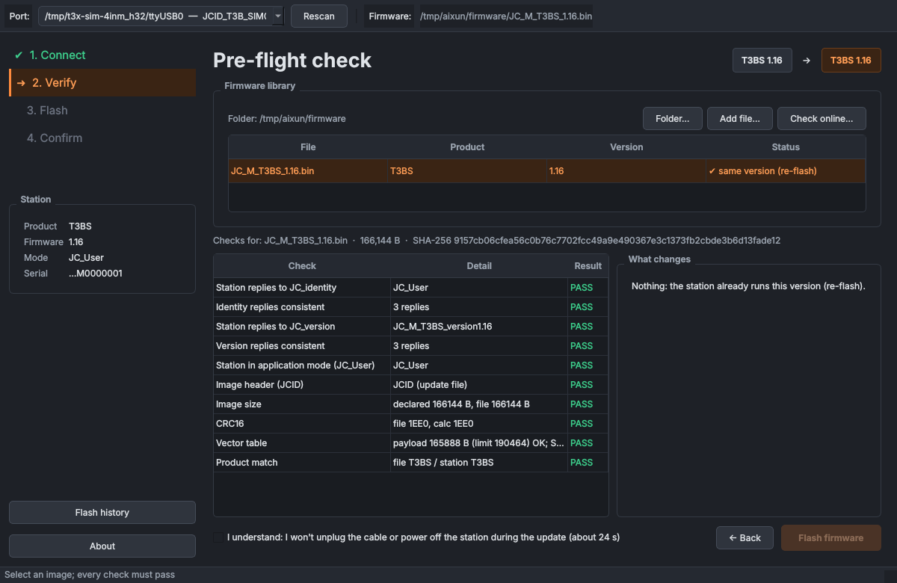

# AiXun T3x safe flasher

Update the firmware of **AiXun T3x soldering stations** (T3B / T3BS and relatives) from
**Linux**, without AiXun's Windows software, with a read-only probe, pre-flight checks,
a recovery path and a graphical updater.



> **Disclaimer.** Flashing firmware always carries some risk. This project is not affiliated
> with or endorsed by AiXun/JCID. Use it at your own risk; read the safety notes below.

---

## Status

| | |
|---|---|
| Version | 0.1.0 (see [CHANGELOG.md](CHANGELOG.md)) |
| Tested hardware | A T3B-labelled station that reports **T3BS**: flashed 1.06 → 1.16, and 1.16 → 1.15 → 1.16 twice, from a **Raspberry Pi 5 running Kali Linux** (October 2026) |
| Tested hosts | Raspberry Pi 5 / Kali (aarch64, Python 3.14): everything. Ubuntu 24.04 (x86_64, Python 3.13): setup and all tests, no station |
| Not tested | Other stations (T3A, T320, T420D …), other distributions, recovery from a *real* interrupted transfer (simulated only) |
| Platforms | Linux only. Windows can't be used: the station's USB interface is rejected by current FTDI drivers (see [docs/SCRIPTS_GUIDE.md](docs/SCRIPTS_GUIDE.md) §1) |
| Tests | 104 automated tests against a simulated station, including byte-for-byte comparison with the hardware-proven script |

---

## What it does

| Feature | Details |
|---|---|
| **Read-only probe** | Identity, version, a 100-query link test and image compatibility. It *cannot* enter the bootloader: only two query commands are allowed |
| **Image checks** | Header, size, CRC, vector table, product line and version, before anything is sent. A T3B image is refused for a T3BS station, also in bootloader mode |
| **Guided GUI** | Connect → Verify → Flash → Done, with a chunk map, live speed and time left, a changelog of what changes, downgrade warnings, and an explicit confirmation that resets when you pick another file |
| **Recovery** | If a transfer is interrupted, the station waits in its bootloader; the GUI detects this, shows where the last flash stopped, and completes the update |
| **Firmware online** | Lists the versions published on aixun-updates.github.io, checks your files are byte-identical to the site's copies, downloads with provenance records. Never flashes on its own |
| **History** | Every update attempt recorded locally (`results/history.jsonl`), viewable in the GUI |
| **Simulator** | A complete simulated station for development and demos: `./aixun gui --sim` |
| **Self-contained workspace** | Code, Python environment, firmware, logs and settings in one folder; nothing configured system-wide beyond the packages and the serial group |

---

## Quick start

Full, distribution-specific instructions: **[INSTALLATION.md](INSTALLATION.md)**. In short (Debian/Ubuntu/Kali/Raspberry Pi OS):

```bash
sudo apt install -y git rsync unzip python3 python3-venv libxcb-cursor0 libxkbcommon-x11-0 libegl1
sudo usermod -aG dialout "$(id -un)"          # then log out and back in

mkdir -p ~/aixun && cd ~/aixun                # the workspace: any folder you like
git clone https://github.com/dzalf/aixun-t3x-safe-flasher.git project
./project/tools/aixun.sh setup                # private venv + folders + ./aixun shortcut
./aixun test                                  # ~4 minutes, no station needed
./aixun gui --sim                             # try the GUI with the simulated station
```

With a station connected:

```bash
./aixun online get T3BS 1.16                  # firmware into firmware/ (use YOUR station's product)
./aixun probe JC_M_T3BS_1.16.bin              # read-only check
./aixun gui                                   # the updater
```

---

## Commands

| Command | What it does | Touches the station? |
|---|---|---|
| `./aixun gui` | Graphical updater | Reads; writes only after you confirm |
| `./aixun gui --sim` | GUI against the built-in simulator | No |
| `./aixun probe FILE.bin` | Read-only probe + image check; report saved in `results/` | Reads only |
| `./aixun flash FILE.bin` | Command-line updater (asks for `yes`) | Writes |
| `./aixun online list / get / compare` | Firmware list, download, comparison with aixun-updates.github.io | No |
| `./aixun history [import]` | Flash history; import earlier logs | No |
| `./aixun test` | Test suite | No |
| `./aixun status` · `reinstall` · `rebuild-venv` | Workspace maintenance | No |
| `./aixun help` | All commands | |

The package also installs `t3x-probe`, `t3x-update`, `t3x-image`, `t3x-online`, `t3x-history`
and `t3x-gui` inside the workspace's venv (`./aixun run <command>`).

---

## Safety notes

- **Probe first.** It's read-only and tells you the station's real product line (the sticker may say T3B while the firmware is T3BS).
- **Keep a rollback image** of the version currently on the station: firmware can't be read back.
- **During a flash** (about 25 s): don't unplug, don't power off. Use a direct USB data cable, no hub.
- **If a flash fails**, leave the station on and connected, and use **Resume / retry** (GUI) or run the same command again. The station waits in its bootloader.
- On desktops running **ModemManager**, consider stopping it during a flash (the GUI tells you how).

---

## Documentation

| Document | For |
|---|---|
| [INSTALLATION.md](INSTALLATION.md) | Setting up from scratch on any Linux distribution |
| [CONTRIBUTING.md](CONTRIBUTING.md) | Developing with the `./aixun` workspace, tests, the simulator, hardware testing |
| [docs/WORKFLOW.md](docs/WORKFLOW.md) | Everything the workspace script does; where firmware downloads come from |
| [docs/SCRIPTS_GUIDE.md](docs/SCRIPTS_GUIDE.md) | The original script-based procedure, protocol and file-format notes, Windows driver background |
| [docs/DEVELOPMENT_REPORT.md](docs/DEVELOPMENT_REPORT.md) | Architecture, safety invariants, decisions, test matrix, hardware log, limitations |
| [docs/devlog/](docs/devlog/) | One log per development session |
| [CHANGELOG.md](CHANGELOG.md) | Release notes |

---

## Related projects

| Project | Relation |
|---|---|
| [c0d3z3r0/aixun_t3x_updater](https://github.com/c0d3z3r0/aixun_t3x_updater) | The original console updater this work is based on |
| [dzalf/aixun_t3x_safe_updater_and_probe](https://github.com/dzalf/aixun_t3x_safe_updater_and_probe) | The earlier console scripts (`t3x_probe.py`, `t3xupdate_safe.py`); still available, unchanged. This repository includes equivalent wrappers |

---

## Credits and license

- **Michael Niewöhner ([@c0d3z3r0](https://github.com/c0d3z3r0))**: the original
  [`aixun_t3x_updater`](https://github.com/c0d3z3r0/aixun_t3x_updater) (kept unchanged in
  `tests/reference/`) and [`aixun_t3a_rev`](https://github.com/c0d3z3r0/aixun_t3a_rev). The protocol,
  file format and flash layout come from his work. Contributors to the original updater are in
  this repository's git history.
- [aixun-updates.github.io](https://aixun-updates.github.io/): unofficial firmware archive and changelogs.
- Probe, hardened updater, package, GUI and workspace: Dr. Daniel Melendrez,
  [Ivory Electronics](https://www.ivory-electronics.com).

Licensed under **GPL-2.0-or-later**, the licence of the original updater. See [LICENSE](LICENSE).
Firmware images are AiXun's and are not distributed here.

AiXun and JCID are trademarks of their respective owners.
